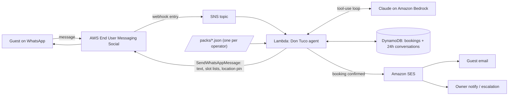

# Don Tuco 🦜, the WhatsApp host for tour operators

**Every guest greeted in seconds, every booking in the ledger.**

Small tour operators across Latin America run their entire business on a personal WhatsApp number. Inquiries arrive at 10pm, during tours, in three languages, and every slow reply is a booking that books elsewhere. Don Tuco is an agentic AI concierge that lives *natively in WhatsApp*: he answers in seconds, checks the real calendar, takes the booking, sends the confirmation, and hands off to a human the moment he's unsure.

Built for the **AWS CDS Agentic AI Partner Hackathon** on **AWS End User Messaging Social (WhatsApp)**, **Amazon Bedrock**, and **Amazon SES**.

## Why this exists (the numbers)

- Guests expect near-instant answers on WhatsApp, but a solo operator mid-tour replies in **hours, not seconds**. Don Tuco's measured reply latency is published live from CloudWatch (`DonTuco/ReplyLatencyMs`).
- A large share of travel inquiries arrive **outside business hours**, when the operator is asleep or on the water (benchmark figures labeled in the demo; live per-operator numbers come from the same CloudWatch metrics).
- Faster first response measurably wins the booking: in hospitality lead studies, the first responder takes the majority of conversions (benchmark, cited in the demo).

**Customer #1 is real:** [Finca Montezuma](https://hero-apps.com), a working cacao farm in Dolphin Bay, Bocas del Toro, Panamá, whose tours previously ran through a desktop copilot pasted into WhatsApp by hand. The go-to-market is the existing pipeline of tourism clients we audit and build for (Bocas del Toro and Caribbean operators).

## One JSON file = one new customer

The engine is operator-agnostic. Everything business-specific (tours, prices, slots, languages, FAQ, escalation, location pin) lives in a **config pack**:

```
packs/finca-montezuma.json   ← customer #1
packs/<your-operator>.json   ← customer #2 is a pull request
```

Don Tuco speaks the pack's languages (Finca Montezuma: Español, English, Nederlands), quotes the pack's prices, and never invents availability: it all comes from tools.

## Architecture



- **Inbound**: EUM Social delivers Meta webhook entries to SNS; no webhook hosting, no Meta app review.
- **Agent**: a Claude tool-use loop on Bedrock with five tools: `check_availability`, `quote_tour`, `book_tour`, `send_location`, `escalate`. Bookings and the 24h conversation state live in DynamoDB (TTL matches Meta's customer-service window).
- **Outbound**: `SendWhatsAppMessage` passes native Meta JSON: free-form text, tappable slot lists, and the farm's location pin.
- **SES**: guest confirmation email + owner notifications/escalations.
- **Honesty by design**: Don Tuco discloses he's an AI when asked, and escalates complaints, price exceptions, and oversized groups to a human.

## Run it locally (no WABA needed)

```bash
npm install
AWS_PROFILE=<profile-with-bedrock> npm run chat
```

You get a terminal REPL against the real Bedrock agent with in-memory bookings; WhatsApp/SES side effects print inline.

## Deploy

```bash
cd infra && sam build && sam deploy --guided
```

Then in the AWS End User Messaging Social console: link the WhatsApp Business Account (Meta embedded signup), set the stack's SNS topic as the event destination, and pass the origination phone number id as the `WhatsAppPhoneNumberId` parameter.

## Hackathon docs

- [docs/devpost-draft.md](docs/devpost-draft.md): submission text
- [docs/video-script.md](docs/video-script.md): ~3 min demo script

## License

MIT
